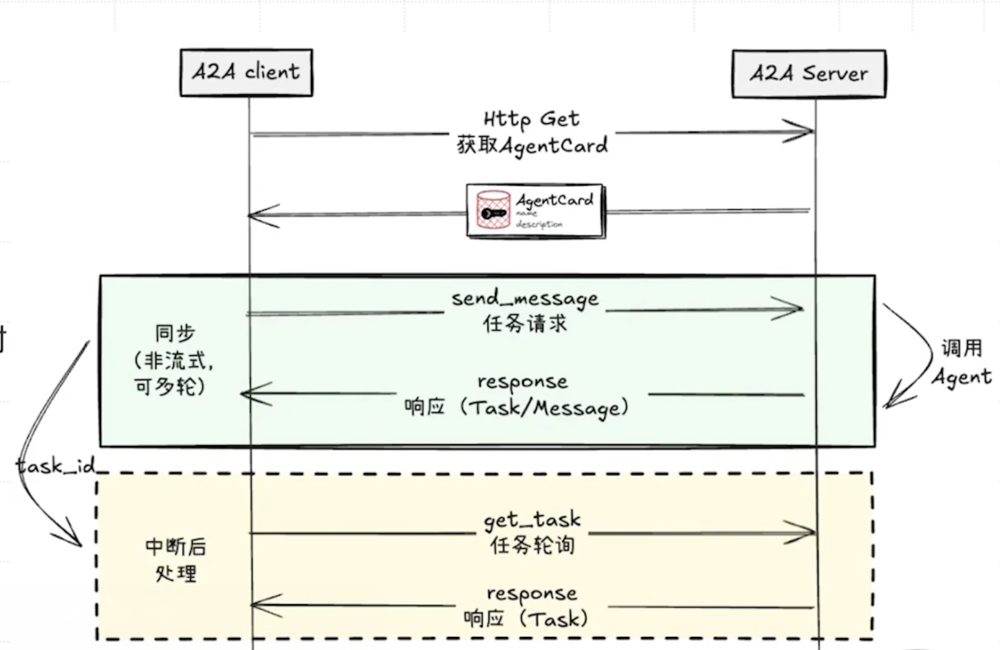

# 智能体的“名片”：Agent Card 与服务发现
- **是什么**：一个标准化的 JSON 文件，用于声明 AI Agent 的能力与身份。
- **位置**：通常发布在服务的公开入口 `/.well-known/agent.json`。
- **作用**：实现动态能力发现（Capability Discovery）。Client Agent 在协作前，可通过 HTTP GET 请求读取此文件，自动了解如何与 Remote Agent 通信，无需人工配置。
- **核心内容**
  - `name, description`：身份信息，说明 Agent 是谁、能做什么。
  - `url`：A2A 服务端接口的基址 URL，明确通信入口。
  - `version`：协议版本，确保协作双方协议兼容。
  - `capabilities`：支持的协议能力（如 `streaming` 流式通信、`pushNotifications` 推送通知等）。
  - `authentication`：所需的身份认证方案（如 `bearer for OAuth2` 令牌认证、`apiKey` 密钥认证等）。

（Agent Card 是 A2A 协议中实现智能体间“自动握手”的关键机制，类比现实中通过名片快速了解对方身份与能力，让不同厂商、框架的 AI Agent 能无人工干预地完成协作前的能力对齐与通信配置。）

# A2A 交互流程与关键要素
- **Task（任务）**：交互的顶层容器，代表一次完整工作，具备唯一的任务 ID（taskId）和多种状态（如 submitted、working、input-required、completed、failed、canceled），用于统筹整个协作过程的生命周期。
- **Message（消息）**：任务过程中客户端与服务端的单次对话单元，通过 role（user 或 agent）区分发送方，一个任务可包含多条消息，是智能体间交互的基本对话载体。
- **Part（内容部件）**：消息和产出物的基本组成单元，支持文本（TextPart）、文件（FilePart）、结构化数据（DataPart）等多模态内容，为 A2A 协议提供了强大的多模态协作能力。
- **Artifact（工件/产出物）**：任务执行完成后的最终成果，如报告、图片、数据集等，结构与消息类似，由一个或多个 Part 组成，是智能体协作的价值交付物。

（这些要素共同构建了 A2A 协议的交互体系，使不同智能体能够围绕“任务”，通过“消息”传递“多模态内容”，最终交付“有价值的产出物”，实现标准化、流程化的智能体间协作。）

# A2A 交互流程详解：Discovery（发现阶段）
- **图中表现**：客户端指向服务端的第一条箭头旁带有“Agent Card”（代理名片）图标。
- **流程说明**：是 A2A 交互的起点。在客户端向服务端分配具体任务前，需先“发现”服务端代理并了解其能力。“Agent Card”承载服务端元信息，包括代理的名称和描述、能执行的任务类型（如数据分析、代码生成、文档撰写等）、接受的输入格式。
- **技术关联**：是建立连接和协商能力的基础，确保客户端发送的任务可被服务端理解和处理。

（该阶段通过“Agent Card”实现智能体间的“能力对齐”，类比现实中合作前先了解对方“能做什么、怎么做”，为后续任务协作奠定基础。）

# A2A 交互流程详解：Send Task（发送任务）
- **图中表现**：客户端向服务端发送包含 `Task -> Message -> Part` 嵌套结构的数据包。
- **流程说明**：客户端发起具体工作请求，请求被封装为 `Task`。
  - 任务初始内容是一条 `Message`，其 `role` 设为“user”。
  - 该消息由一个或多个 `Part` 组成，例如用户输入“帮我分析这份销售数据并生成图表”时，请求可能包含 `TextPart`（文字指令）和 `FilePart`（销售数据 CSV 文件）。
- **技术关联**：服务端收到后创建任务实例，分配唯一 `taskId`，并可立即向客户端推送 `Task` 对象或 `TaskStatusUpdateEvent`，将任务状态置为 `submitted`，告知客户端“任务已收到并进入队列”。

（此阶段是 A2A 协作的“任务启动环节”，通过 `Task-Message-Part` 的嵌套结构，实现多模态任务请求的标准化封装与传递，为后续任务执行奠定基础。）

# A2A 交互流程详解：Push Notifications（推送通知）
- **图中表现**：从服务端指向客户端的多条虚线箭头，右侧配有 A2A Client 相关的智能体图示。
- **流程说明**：体现 A2A 交互的异步和流式特性。任务状态变为 `working` 后，服务端持续向客户端推送通知，实时同步任务进展，包含三类通知：
  - `TaskStatusUpdateEvent`：任务状态更新事件，如从 `submitted` 变为 `working`；若需用户补充信息（如“请确认图表类型”），状态会变为 `input-required`，任务暂停等待客户端回复。
  - `TaskArtifactUpdateEvent（中间产出）`：推送任务过程中的中间结果，如报告提纲、部分生成的代码等临时 Artifact。
  - `Message`：服务端代理发送 `role` 为“agent”的消息，用于对话式交流（如“我正在网上搜索相关资料…”）。
- **技术关联**：流式通信通常通过 `Server-Sent Events (SSE)` 实现，支持服务端单向、持续向客户端发送数据，适配长任务的进度更新场景。

（该阶段是 A2A 协作的“进度同步环节”，通过异步推送机制让客户端实时掌握任务状态与中间成果，保障长周期、复杂任务的人机协同体验。）

# A2A 交互模式一：同步请求与响应
- **场景**：适用于快速、简单的任务，可一次性返回结果。
- **流程**
  - Client 发送 HTTP POST 请求。
  - Server 执行整个任务。
  - Server 将包含完整结果的 Task 或 Message 对象一次性返回。
- **中断处理**：若交互中断，Client 可通过 `task_id` 轮询（`get_task`）获取最终结果。

（该模式是 A2A 协议中处理“短平快”任务的标准化方式，类比传统 API 接口的请求-响应流程，确保简单任务的高效、同步处理。）

# A2A 交互模式二：流式协作与异步通知
- **场景**：适用于复杂、耗时的长任务，需持续反馈任务进展。
- **流程（基于 SSE – Server-Sent Events）**
  - Client 发送请求。
  - Server 立即返回状态为 `submitted` 的 Task。
  - Server 执行过程中持续推送多个 `TaskStatusUpdateEvent`。
  - 任务产出时推送 `TaskArtifactUpdateEvent`。
  - 任务完成时推送状态为 `completed` 的 Task，关闭连接。
- **中断处理**：Client 可通过 `resubscribe` 重新连接到 SSE 流，恢复任务状态追踪。

（该模式是 A2A 协议应对“长周期复杂任务”的核心方案，借助 SSE 技术实现服务端到客户端的异步流式通知，确保任务执行过程中状态与成果的实时同步，类比视频流的“边传边看”，适配如大规模数据分析、多智能体协同决策等耗时场景。）

# A2A 落地场景一：AI 驱动的自动化招聘
- **痛点**：招聘顶尖人才是企业核心战略任务，但执行过程存在信息孤岛（数据分散）、协同低效（面试预约耗时）、流程黑箱（进度不透明）等问题，导致效率被杂事挤压，无法聚焦“识人”核心。
- **协作链条**
  1. 招聘经理 Agent（Client）发起“找候选人”任务。
  2. 通过 A2A 调用 LinkedIn Agent（Remote），获取候选人列表（Artifact）。
  3. 经理筛选后，招聘经理 Agent 调用日历 Agent 和邮件 Agent，协调并发送面试邀请。
  4. 面试后，调用背调服务 Agent 发起背调。
- **价值**：通过标准化的 Agent 协作，将复杂多系统的招聘工作流自动化串联，解决传统招聘的低效与信息割裂问题。

# A2A 落地场景二：企业采购流程自动化
- **痛点**：员工申请采购新设备时，流程繁琐且涉及多部门审批，进度不透明。
- **协作链条**
  1. 员工的个人助理 Agent（Client）发起任务：“我需要一台新的 M3 Max 笔记本电脑用于 AI 开发。”
  2. 通过 A2A 调用公司采购 Agent（Remote）。
  3. 采购 Agent 检查公司政策和预算，发现该型号需总监审批，于是通过 A2A 调用经理审批 Agent。
  4. 经理在审批系统（或邮件）中点击同意后，经理审批 Agent 将批准状态返回给采购 Agent。
  5. 采购 Agent 确认合规后，通过 A2A 调用财务 ERP Agent（如 SAP Agent），生成采购订单（PO）并向供应商下单。
  6. 订单状态（如“已发货”）通过 A2A 链条实时同步回员工的个人助理 Agent。
- **价值**：将跨部门的手动审批流程完全自动化，确保合规性的同时，为员工提供端到端的流程透明追踪。

