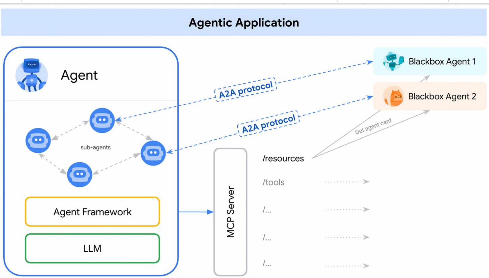

# Agent 世界观类比：个体（MCP）与社会（A2A）
| 维度   | `MCP`                                |                      A2A                    |
| 角色   | `为单个 Agent 配备标准化的“感官”与“四肢”`| 为多个 Agent 制定社会化的“外交语言”与“协作礼仪”|
| 解决目标 | `让一个 Agent 能看（读文件）、能听（API 查询）、能做（执行命令）`| 让一群 Agent 能开会、能分工、能协作 |

（该类比清晰区分了 MCP 和 A2A 的定位`：MCP 聚焦单个智能体的“能力拓展”`，类似给智能体装上感知和执行的器官；`A2A 聚焦多智能体的“社会协作”`，类似为智能体群体建立沟通与协作的规则，二者结合构成了智能体生态的完整图景。）

# 全面比较：MCP vs. A2A
| 维度       | MCP（模型上下文协议）| A2A（智能体间协议）|
|------------|----------------------------------------------------------------|----------------------------------------------------------------|
| 核心目标   | 赋能个体：使 Agent 安全使用外部工具/数据| 赋能群体：使 Agent 之间协作完成复杂任务 |
| 通信模型   | `中心化（Host ↔ Server）`| `分布式（Agent ↔ Agent）`|
| 核心抽象   | 工具 (Tools)、资源 (Resources) | 任务 (Tasks)、智能体 (Agents) |
| 交互焦点   | 具体、可执行的动作 | 抽象、策略性的协作 |
| 解决问题   |  Agent “能不能干”|  Agent “能不能合作干”|
| 发展阶段   | 现在时（已有成熟应用）| 未来时（前沿探索）|

## 场景思辨：何时用 MCP？何时用 A2A？
用 MCP 就够了，如果…
• 你正在构建一个单一的、全能的 Agent。
• 你需要让这个 Agent 集成多种工具（访问 API、读写文件、执行代码）。
• 场景是 Host 应用（如 IDE）与工具集之间的交互。
• 例子：在 Cursor 中开发一个能操作 GitHub 和本地文件的代码助手。
你需要 A2A，如果…
• 你的任务需要多个、不同领域的专业 Agent 协同。
• 这些 Agent 由不同团队/公司开发，或基于不同技术栈。
• 你需要管理复杂的、长时间运行的协作任务。
• 例子：构建一个企业自动化平台，让财务 Agent、供应链 Agent、销售 Agent 协同工作

# 终极协同范式：当 A2A Agent 内部使用 MCP
工作流示例：
• 高层协作 (A2A)：`Code Agent` 通过 `A2A` 向 `GitHub Agent` 请求：
“请分析 X 仓库上个季度的代码提交活跃度。”
• `底层执行 (MCP)`：GitHub Agent 接收到任务后，在其内部
• 通过 MCP 调用 `github_api_tool` 来拉取 commit 历史。
• 通过 MCP 调用 `filesystem_tool` 将数据写入本地 CSV 文件。
• 通过 MCP 调用 data_analysis_tool (Pandas) 对 CSV 文件进行
`分析`。
• 结果返回 (A2A)：GitHub Agent 将`分析报告（Artifact）`通过 A2A 
返回给Code Agent。

# MCP 与 A2A 协同场景：一站式自动化企业财报分析
1. 总控 Agent (A2A) 发起任务：“生成 Q2 财报草稿”。
2. 总控 Agent → (A2A) → 销售 Agent：“提供 Q2 销售数据”。
• 销售 Agent 内部 (MCP) 调用 Salesforce API Tool。
3. 总控 Agent → (A2A) → 市场 Agent：“提供 Q2 营销活动
ROI”。
• 市场 Agent 内部 (MCP) 调用 Google Analytics API Tool。
4. 总控 Agent 汇总数据，发现异常 → (A2A) → 供应链 Agent：“
查询 SKU-123 的库存成本为何上升”。
• 供应链 Agent 内部 (MCP) 调用 SAP API Tool。
5. 所有信息收齐，总控 Agent 生成最终财务报告。

