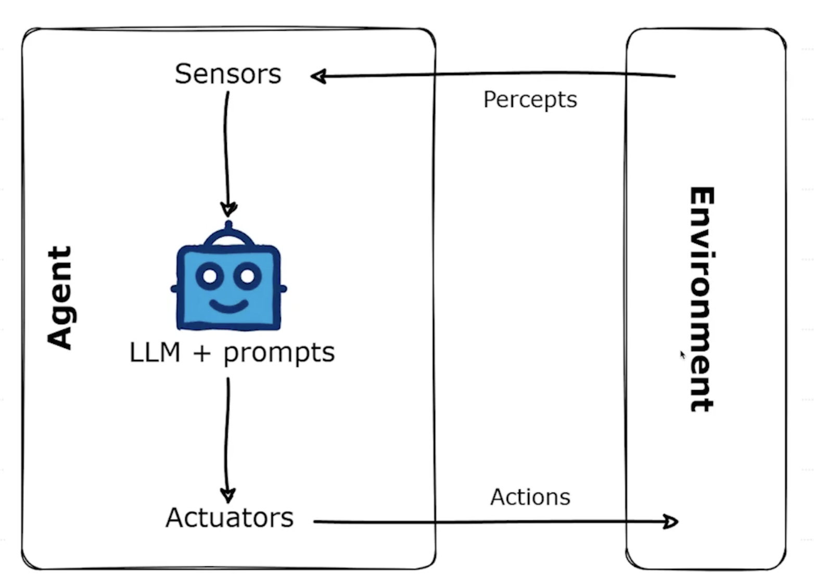

## 引子：LLM 已经很强了，为什么还需要 Agent？

* LLM（大语言模型）：擅长理解和生成文本，但通常是 `“一次性” 的响应(输入->思考->输出)`。你问一句，它答一句。
* Agent（智能体）：不仅仅是对话，它是一个`能自主规划、使用工具、并根据环境反馈采取行动的系统`。它让 LLM 从一个 “聊天机器人” 进化成一个能完成复杂任务的 “智能助理”。`LLM+记忆+工具使用+长任务规划`

#### Agent 基本概念与特点
- 自主性（Autonomy）：
  Agent 可以在没有人为干预的情况下根据设定的目标和当前环境，自主地做出决策和执行动作。
- 感知（Perception）：
  Agent 能够通过各种方式（如文本输入、API 返回、传感器数据）感知其所处的环境和状态。
- 行动（Action）：
  Agent 能够执行一系列动作来改变环境或达成目标。这些动作可能包括调用 API、执行代码、生成文本、与其他系统交互等。
- 目标导向（Goal-oriented）：
  Agent 的所有行为都是为了实现一个或多个预设的目标。

* Agents 通过传感器（`Sensors`）收集各类数据（`Percepts`），借助推理引擎（`Reasoning Engine`）提出合理解决方案（Rational Solutions），并通过控制系统（`Actuators`）执行动作（`Action`），以此提升能力。

#### Agent 核心能力与独特优势
- **复杂任务分解与规划（Task Decomposition & Planning）**：
  - LLM 强大的理解和推理能力，可以将一个复杂的大目标分解成一系列可执行的小步骤。
  - 能够动态调整计划以应对意外情况。
- **工具使用（Tool Using）**：
  - Agent 可以被赋予使用各种“工具”的能力，LLM 负责决定何时以及如何使用这些工具。
  - **工具示例**：搜索引擎（获取最新信息）、计算器（进行数学运算）、代码执行器（运行 Python 脚本）、数据库接口（查询和修改数据）、API 调用（与其他服务交互，如天气 API、日历 API）
- **长期记忆与学习（Long-term Memory & Learning）**：
  - 通过外部记忆模块（如向量数据库），Agent 可以存储和检索过去的经验、知识和对话历史，从而实现更连贯的交互和持续学习。
- **自主性与适应性（Autonomy & Adaptability）**：
  - Agent 能够在没有人持续干预的情况下，根据环境变化和任务进展自主推进工作。
- **与外部世界交互（Interaction with the External World）**：
  - 不再局限于文本生成，Agent 可以通过工具实际影响和改变外部系统或获取外部信息。

#### Agent 开发流程与关键模块解析
1. 定义目标与范围（Define Goal & Scope）：
    1. Agent 要完成什么**具体任务**？（例如：预订机票、撰写报告、回答特定领域问题）
    2. 任务的**边界和约束**是什么？
2. 选择核心 LLM（Choose Core LLM）：
    1. 选择一个具备良好**指令遵循能力**、**推理能力**和（如果需要）**工具使用能力**的 LLM (如 DeepSeek)。
3. 设计 Agent 架构（Design Agent Architecture）：
    1. **核心逻辑/控制器 (Controller/Orchestrator)**：负责驱动整个 Agent 的运行流程（如 ReAct 循环）。
    2. **规划模块 (Planner)**：LLM 思考如何分解任务、制定计划。
    3. **工具集 (Tool Set)**：定义 Agent 可以使用的工具，并提供调用接口。
    4. **记忆模块 (Memory Module)**：短期记忆（如对话历史）、长期记忆（如知识库）。
    5. **行动执行器 (Action Executor)**：实际执行 LLM 决定的动作。
4. 工具开发与集成 (Develop & Integrate Tools)：
    1. 为 Agent 需要的每个功能开发或封装成一个“工具”。
    2. 确保 LLM 能够理解工具的描述、输入输出格式。
5. 提示工程 (Prompt Engineering)：
    1. 至关重要！设计精良的 Prompt 来引导 LLM 进行思考、规划、工具选择和最终输出。
    2. Prompt 建议包含：Agent 角色、目标、可用工具描述、输出格式要求、思考链模板等。
6. 记忆机制实现 (Implement Memory)：
    1. 选择合适的记忆存储方式（如简单的列表、向量数据库）。
7. 测试、评估与迭代 (Test, Evaluate & Iterate)：
    1. 在各种场景下测试 Agent 的表现。
    2. 评估其任务完成率、效率、鲁棒性。
    3. 根据测试结果不断优化 Prompt、工具、计划逻辑等。

## agent的经典范式 Re-act
* `思维链+工具调用=Re-act`
* Reasoning + Actions

### agent Prompt的一般构成
* agent Prompt 的核心构成：
1、System Prompt（角色与全局设定）：定义 Agent 身份、专业领域、基本行为准则和总体目标。这是 DeepSeek Agent 的 “灵魂”。
示例：你是一个小红书爆款文案专家，擅长结合最新潮流和产品卖点，创作引人入胜的文案。
2、User Prompt（任务指令）：用户具体输入的任务需求。
示例：请为一款「XXXX 口红」生成一篇小红书文案，要求有标题、正文、标签和表情符号，语气要甜美活泼。
3、Tool Description（工具描述）：在 system 或 tools 参数中详细描述可用工具的功能、参数和用途。这直接影响 DeepSeek 是否能正确调用工具。
示例（自然语言描述）：我有一个名为'search_web' 的工具，可以帮助你搜索最新的美妆趋势和产品评价。（与 JSON Schema 结合使用）
4、Few-shot Examples（示例引导）：通过提供输入 - 输出的少量示例，帮助 DeepSeek 理解复杂任务模式或特定的行为规范。（尤其是用于引导 Agent 的思维过程）。

#### 为何需要工具调用？
- LLM 存在知识滞后性、计算限制、无法直接与外部系统交互等问题。
- 工具调用是扩展 LLM 能力边界的核心机制，赋予 Agent 感知和执行外部世界的能力。

### agent开发平台dify
- Dify 开发平台简介
  - 平台定位：面向零基础人员的 Agent 开发平台
  - 基础概念：Backend as Service、LLMOps、工作流、提示词编排等
- Dify 平台使用方法
  - 云服务：开箱即用的 Dify 在线服务
  - 社区版：使用 Docker (Compose) 部署
  - 上手操作：账号注册、新建应用、节点配置、提示词设置、调试预览
  - 核心功能：内置工具接入、变量管理、条件分支、迭代与模板转换

Dify: 定义 (Define) 与重塑 (Modify) 你的AI应用
Dify = Do It For You.

**官方定位**：Dify 是一款开源的大语言模型应用开发平台，它深度融合了**后端即服务 (BaaS)** 和 **LLMOps** 的核心理念。
**核心价值**：为开发者提供一站式解决方案，让你告别“重复造轮子”，真正专注于**应用的创新**和**业务逻辑**。
**内置关键技术栈**：
- 支持数百种模型
- 直观的 Prompt 编排界面
- 高质量的 RAG 引擎
- 稳健的 Agent 框架

