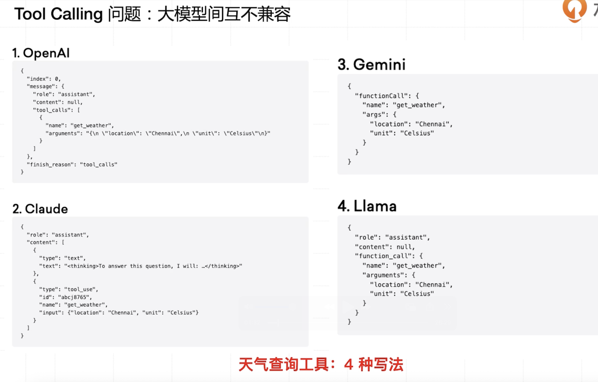
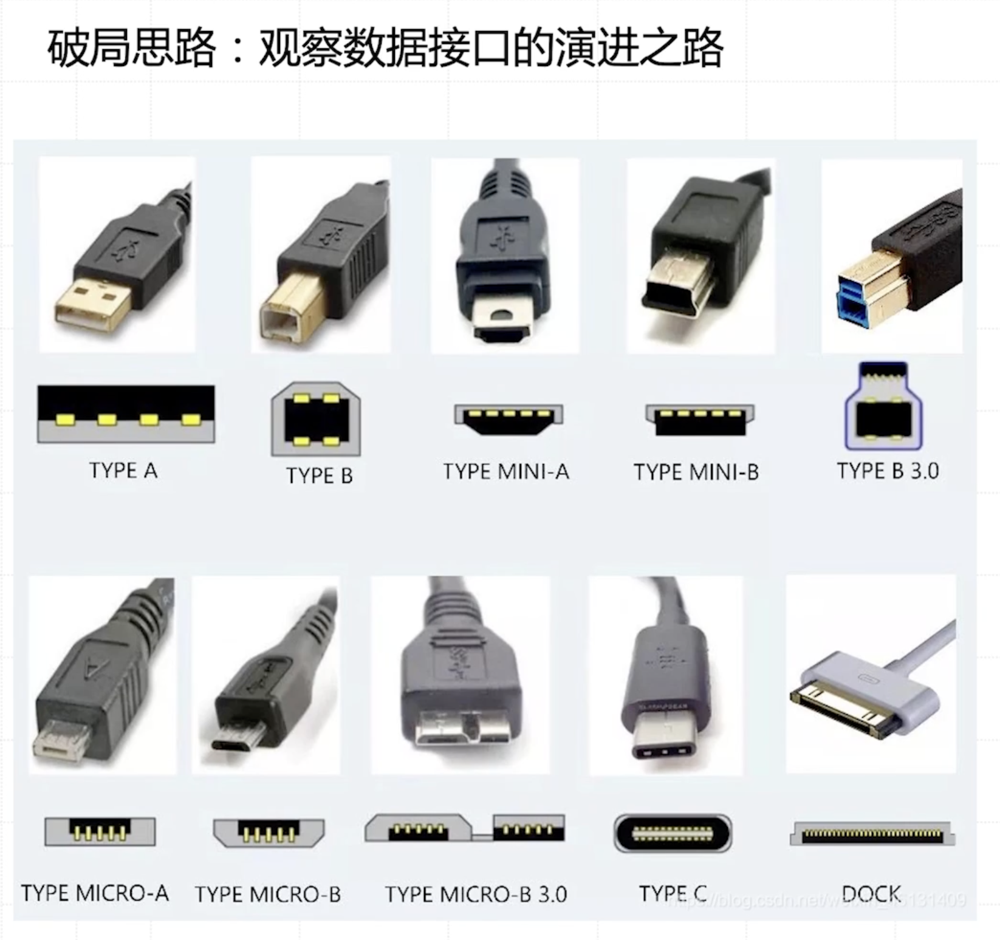
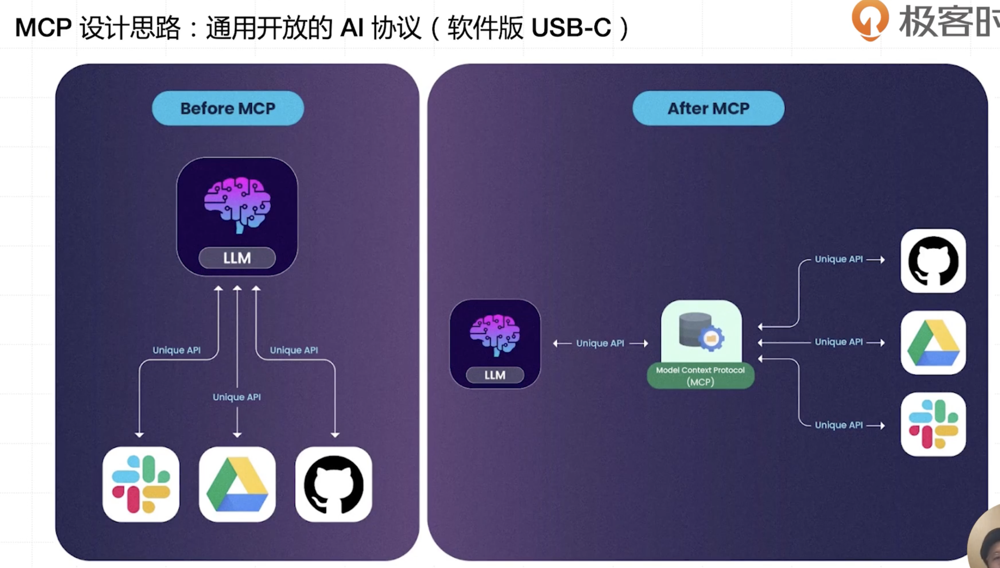

## tool call的缺陷
1、兼容性
* tool call在不同的大模型平台不一定是兼容的(例如claude code、gemini、llama、openai)
* 从而导致一个简单的tool需要在不同的平台写多次!

* 就像是手机和电脑的数据线一样,从百花齐放发展成统一的type-c接口、usb接口

* `也可以理解成编辑器领域的lsp语言服务器协议`

2、mcp的分布式架构
1) mcp的分布式架构
* 数据不离线、本地执行：“有了 MCP，你的敏感数据（代码、文档、密钥）再也不需要离开你的电脑。AI 应用（如 Cursor）通过 MCP 协议，只是向你`本地运行的工具（比如文件系统 Server）请求它需要的信息摘要`，比如‘给我这个文件的结构’或‘这个函数的第一行是什么’。整个过程，数据的所有权和访问权牢牢掌握在你手里。

流程如下：
本地部署 MCP 服务器：你在自己的本地服务器（如个人电脑或企业私有云）部署 MCP 服务网关，并配置好与可信天气数据源的加密通信链路（例如通过 TLS 1.3 直连某权威气象机构的 API，并存储该机构的 CA 证书用于身份验证）。
请求发起：你向本地运行的 AI 应用（如基于开源大模型的本地助手）发送指令 “查询北京明天的天气”。
`MCP 协议交互`：AI 应用通过 MCP 协议向你本地的 `MCP 服务器`发送查询请求，MCP 服务器根据请求，向本地配置的天气数据源（或直连的气象机构 API）获取信息摘要（例如仅获取 “北京明天晴，气温 10-20℃” 的关键信息，而非原始全量数据）。
数据本地化：整个过程中，你的`查询指令仅在本地网络流转，天气数据的获取和处理也在本地 MCP 服务器完成`，原始数据（如气象机构的详细观测数据）可存储在本地数据库，不会上传至任何第三方云端。

2) Function Call 的集中式依赖
Function Call 通常作为大模型的`内置功能`（如 OpenAI 的 Chat Completions API），需`通过模型提供商的云端服务间接调用外部工具`。例如，当用户请求调用天气 API 时，模型会生成包含函数名和参数的 JSON 结构，由 OpenAI 服务器转发至第三方 API，结果再通过云端返回给用户。`这种模式下，数据需经过模型提供商的基础设施中转`，存在以下风险：
数据过境风险：敏感信息可能因模型提供商的全球节点分布而跨越司法管辖区，违反数据主权法规（如中国《数据安全法》）。
供应链安全：依赖单一云厂商的服务，若其基础设施出现漏洞（如 API 密钥泄露），可能导致连锁反应。

* `Function call流程如下`：
请求发起：你向大模型发送指令 “查询北京明天的天气”。
函数调用生成：大模型生成包含天气 API 函数名（如get_weather）、参数（城市 “北京”、日期 “明天”）的 JSON 结构，`通过模型提供商(例如openai,DeepSeek)的云端服务器转发。`
数据流转：模型提供商的服务器将请求发送至天气 API 服务商（如某天气平台），天气平台返回北京明天的详细天气数据（包括温度、降水概率、风速等），该数据需经过模型提供商的云端中转后，再返回给你。

MCP 可以实现数据不经过模型 API 服务商的中转，直接在用户本地(用户私有化部署mcp服务器)完成数据交互和结果返回。

## function call和mcp的对比
# MCP 与 Function Calling 五个维度的对比
| 维度               | Function Calling                                  | MCP                                                    |
| ------------------ | ------------------------------------------------- | ------------------------------------------------------ |
| 1. 它是什么？      | 一种 LLM 的内在能力                               | 一套应用间的通信协议                                   |
| 2. 它在哪里工作？  | 在 LLM 内部，是模型推理的一部分                   | 在 LLM 外部，在 Host 应用和 Server 进程之间            |
| 3. 它解决的核心问题？ | “我应该用哪个工具？”(语义理解与意图识别)        | “我的工具有哪些？在哪？如何安全地调用它们？”(发现、连接、管理、执行) |
| 4. 谁是主角？      | LLM (大模型)                                      | Host Application (宿主应用，如 IDE)                    |
| 5. 最终产物？      | 一个结构化的调用请求 (JSON 对象)                  | 一个标准化的、可被任何模型使用的工具生态               |

## mcp的设计思路
* 作为不同平台和大模型之间的协议标准,从而让一个tool写一次就行,不需要写多次!

* `mcp是给host调用的(例如gemini-cli,claude code); 而function call是大模型自己调用的`
* `对于mcp来说,只需要在初始化的时候给llm提供mcp信息,然后由llm决定什么时候调用工具,然后用host实际来调用工具!`

### gemini-cli调用mcp的流程
大模型返回 FunctionCall 后,Gemini CLI 如何实际调用 MCP 服务器的具体代码实现。

核心执行流程代码
1. 非交互模式下的工具调用循环
在 packages/cli/src/nonInteractiveCli.ts 中,有一个 while (true) 循环处理工具调用: nonInteractiveCli.ts:99-158

关键步骤:

收集工具调用请求: 当流式响应中包含 ToolCallRequest 事件时,将其添加到 toolCallsToExecute 数组 nonInteractiveCli.ts:116-130

执行所有工具: 流结束后,使用 Promise.all 并行执行所有工具调用 nonInteractiveCli.ts:132-156

发送结果回模型: 将所有工具的 responseParts 作为新的用户消息发送给 Gemini API nonInteractiveCli.ts:157-158

2. executeToolCall 函数
executeToolCall 是实际执行工具的核心函数,它位于 @google/gemini-cli-core 包中。这个函数会:

从 ToolRegistry 中查找对应的工具
验证参数
处理用户确认(如果需要)
调用工具的 execute() 方法
将结果转换为 FunctionResponse 格式
3. MCP 工具的执行
对于 MCP 工具,当 execute() 被调用时,会通过 DiscoveredMCPTool 类来处理。这个类会:

检查信任设置: 如果服务器设置了 trust: true,跳过确认 mcp-server.md:405-408

准备参数并调用: 将参数传递给底层的 CallableTool,它会通过 MCP 协议调用服务器 mcp-server.md:431-441

处理响应: MCP 服务器返回的 CallToolResult 会被转换为两部分:

llmContent: 给模型的原始内容
returnDisplay: 给用户的格式化显示 mcp-server.md:447-450
4. 交互模式下的处理
在交互式 UI 中,useGeminiStream.ts 中的逻辑类似: useGeminiStream.ts:953-989

它会:

过滤出已完成且准备提交的工具调用
收集所有 responseParts
通过 submitQuery() 发送回模型
完整的调用链
用户提示   
  → `Gemini API 返回 FunctionCall  `
  → `CLI 收集 ToolCallRequest 事件  `
  → executeToolCall(config, toolCallInfo, abortSignal)  
  → ToolRegistry.getTool(toolName)  
  → DiscoveredMCPTool.execute(params)  
  → `CallableTool 通过 MCP 协议调用服务器 ` 
  → `MCP 服务器返回 CallToolResult ` 
  → `转换为 FunctionResponse`  
  → `作为新请求发送回 Gemini API(注意是作为新请求发送给大模型!)`  
  → `模型基于工具结果生成最终响应`  

测试用例 packages/cli/src/nonInteractiveCli.test.ts 验证了这个流程

# LLM + MCP 的核心特点与优势
- **实时双向通信**：不同于传统的请求 - 响应 API 模式，MCP 赋予 AI 动态获取与发送信息的能力，实现信息即时互通与流转。
- **工具和服务的自动发现机制**：摒弃了手动设置的繁琐，AI 能够自主检测并集成新工具，提升效率与便捷性。
- **卓越的上下文感知能力**：在交互过程中，AI 能保留并理解上下文，进而生成更智能、贴切的响应，让交流更加自然流畅。
- **高可伸缩性与灵活性**：支持在不干扰现有工作流程的前提下轻松集成新服务，满足不断变化的业务需求。
- **强化的安全性保障**：采用标准化的安全协议，为所有集成提供全方位、无死角的安全防护，确保数据与交互的安全可靠。
