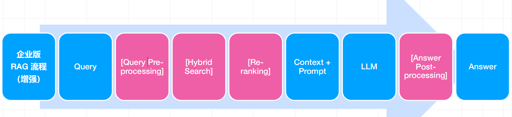
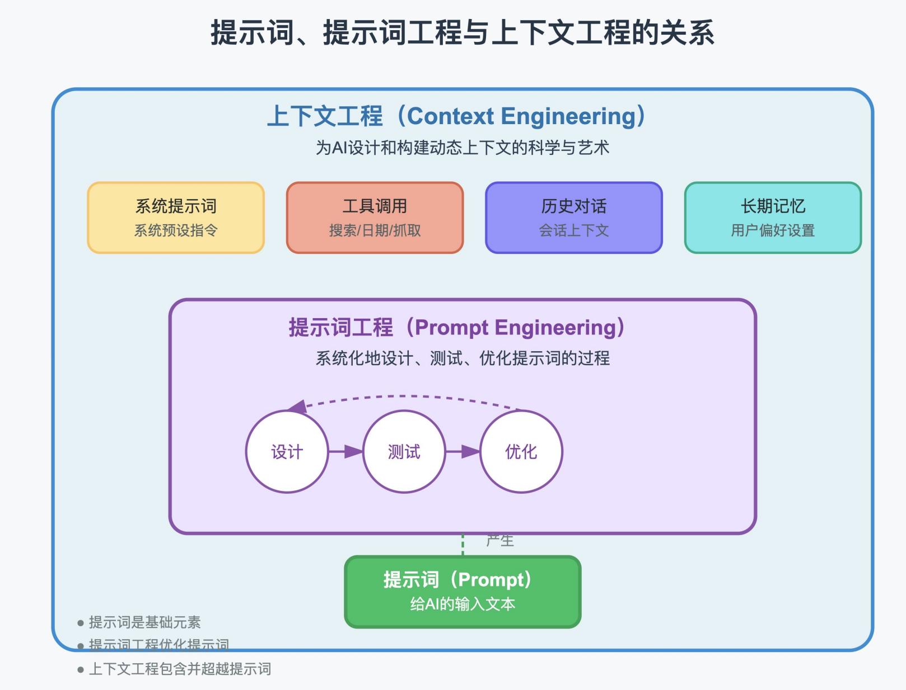

### “企业版” RAG 系统新增模块价值分析
• 查询预处理： 修正错别字、识别⽤户意图、扩展同义词。
• 混合检索： 解决向量检索对关键词不敏感的问题。
• 重排器 ： 对初步召回结果进⾏⼆次排序，提升上下⽂质量。
• 答案后处理： 过滤不当内容、格式化输出（如转为 JSON）。
• 可观测性系统： 记录每⼀次交互，为迭代优化提供数据。



#### 查询预处理 (Query Pre-processing)
⽬标： 将⽤户的“原始问题”转化为对机器更友好的“标准问题”。
• 常⽤技术：
1. 查询扩展 (Query Expansion)：
• “AI 怎么部署？” -> “AI ⼈⼯智能模型如何进⾏私有化部署？”（增加同义词和上下⽂）。
2. 查询分解 (Query Decomposition)：
• “Dify 和 FastGPT 哪个好，它们分别怎么部署？” -> 分解为两个⼦问题。
3. 假设性⽂档嵌⼊ (HyDE)：`文档查文档`
• 先让 LLM 根据问题“幻想”⼀个完美的答案⽂档，再⽤这个幻想⽂档的 Embedding 去检索，能
更好地匹配到概念相似的真实⽂档

#### 混合检索 (Hybrid Search)
问题： 单纯的向量检索有时会“失灵”。
• ⽤户提问：“公司的‘麒麟’项⽬进展如何？
• 向量模型可能不理解“麒麟”这个特定代号，导致检索失败。
• 解决⽅案： 向量检索 + 关键词检索（如 BM25）
• 向量检索：
• 负责理解语义相似度。（如：“年会怎么办” vs “年度庆典活动安排”）
• 关键词检索：
• 负责匹配专有名词、产品代号、ID 等。（如：“麒麟项⽬”、“订单号 89757”）
• 实现⽅式： 分别从两个引擎检索，然后⽤ Reciprocal Rank Fusion (RRF) 算法合并排序。
• （两路召回，合并结果，取⻓补短，显著提升召回率。 ）

#### 重排器 (Re-ranker)
• 问题： 初步召回的 Top-K 个⽂档⽚段，不⼀定都是最⾼质量的。 可能有些只是包含了相同的词，但并
⾮最佳答案。
• 解决⽅案：
• 使⽤⼀个更轻量、更专注的模型（如 Cross-Encoder）对初步召回的 Top-K 个⽚段和原始问题进
⾏⼆次打分。
• 这个模型会判断（Query, Document_Chunk）对的真实相关性。
• 选取⼆次打分后 Top-3 或 Top-5 的⽚段作为最终的上下⽂。
• 价值： ⽤较⼩的计算开销，⼤幅提升喂给 LLM 的上下⽂“信噪⽐”。

#### ⾯向 RAG 的提示词⼯程
• RAG 的 Prompt 与通⽤聊天 Prompt 不同，有其特定范式。
• ⼀个好的 RAG Prompt 模板，可以有效地约束模型的⾏为，防⽌其“胡说⼋道”（幻觉）
```markdown
你是一个专业、严谨的问答机器人。请根据下面提供的上下文信息来回答用户的问题。
要求：
1. 只能使用上下文中提供的信息，不要依赖你自己的内部知识。
2. 如果上下文没有提供足够的信息来回答问题，请明确告知“根据现有知识库，我无法回答这个问题”。
3. 答案应清晰、简洁，并尽可能引用原文。
【上下文】
---
{retrieved_context}
---
【用户问题】
{user_query}
【你的回答】
```

## 上下文工程包含提示词工程


### 记忆工程、上下文工程、提示词工程
┌─────────────────────────────────────────────────────────────────┐
│                      上层：用户/业务场景                          │
│  （示例：AI招聘助手、智能客服、领域问答机器人等）                 │
└───────────────────────────────┬─────────────────────────────────┘
                                │
                                ▼
┌─────────────────────────────────────────────────────────────────┐
│  核心交互层：提示词工程（Prompt Engineering）——“指令翻译官”       │
│  ┌─────────────┬─────────────┬─────────────┬─────────────┐      │
│  │ 角色设定    │ 任务结构化  │ Few-Shot示例 │ 约束明确化  │      │
│  └─────────────┴─────────────┴─────────────┴─────────────┘      │
│  核心作用：将用户需求转化为LLM可理解的精准指令                  │
└───────────────────────────────┬─────────────────────────────────┘
                                │ （指令+数据输入）
                                ▼
┌─────────────────────────────────────────────────────────────────┐
│  数据管理层：上下文工程（Context Engineering）——“信息管家”        │
│  ┌─────────────┬─────────────┬─────────────┬─────────────┐      │
│  │ 内容压缩    │ 优先级排序  │ 结构化处理  │ 滑动窗口    │      │
│  └─────────────┴─────────────┴─────────────┴─────────────┘      │
│  核心作用：优化上下文窗口，筛选/整理关键信息（含记忆工程的输出） │
└───────────────────────────────┬─────────────────────────────────┘
                                │ （优化后的上下文输入）
                                ▼
┌─────────────────────────────────────────────────────────────────┐
│  知识存储层：记忆工程（Memory Engineering）——“长期记忆库”         │
│  ┌─────────────┬─────────────┬─────────────┬─────────────┐      │
│  │ 外部存储    │ 记忆分层    │ RAG检索     │ 记忆更新    │      │
│  └─────────────┴─────────────┴─────────────┴─────────────┘      │
│  核心作用：提供长时记忆（用户偏好、领域知识），突破窗口限制      │
└───────────────────────────────┬─────────────────────────────────┘
                                │ （记忆数据反馈至上下文工程）
                                ▼
┌─────────────────────────────────────────────────────────────────┐
│                      底层：LLM模型（如GPT-4、Llama 3）           │
│  核心作用：基于“指令+优化后上下文”生成符合预期的输出             │
└───────────────────────────────┬─────────────────────────────────┘
                                │
                                ▼
┌─────────────────────────────────────────────────────────────────┐
│                      输出：满足用户需求的结果                    │
│  （示例：简历筛选结果、客服回复、领域知识问答答案等）            │
└─────────────────────────────────────────────────────────────────┘

. 层级关系（从下到上支撑）
底层：LLM 模型是基础算力，依赖上层输入的 “指令 + 数据” 生成输出；
知识存储层：记忆工程提供 “长时记忆”（如招聘标准、用户偏好），是上下文的重要数据来源；
数据管理层：上下文工程对 “记忆数据 + 用户输入数据” 进行优化，适配 LLM 窗口限制；
核心交互层：提示词工程将用户需求转化为精准指令，指导 LLM 如何利用优化后的上下文；
上层：面向具体业务场景，三者协同支撑 LLM 完成复杂任务。
